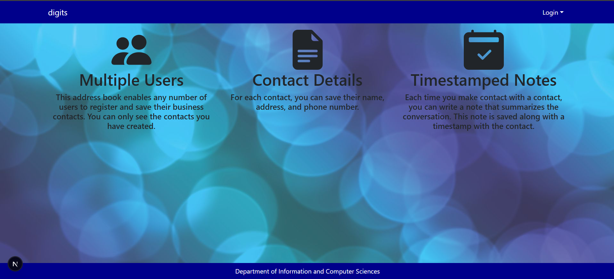
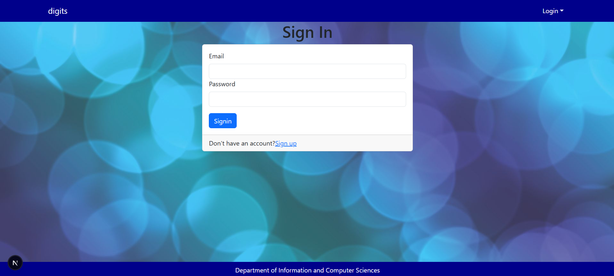
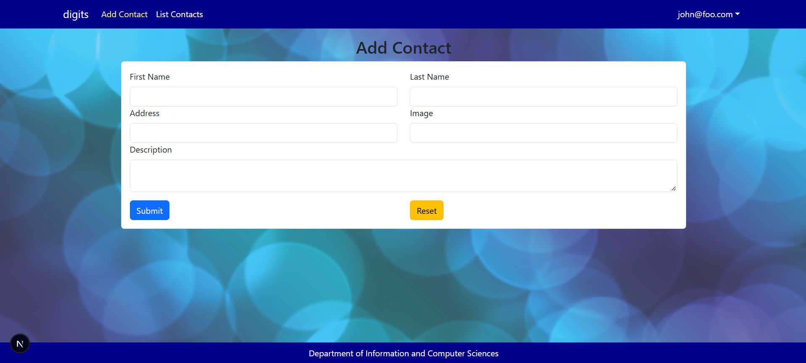
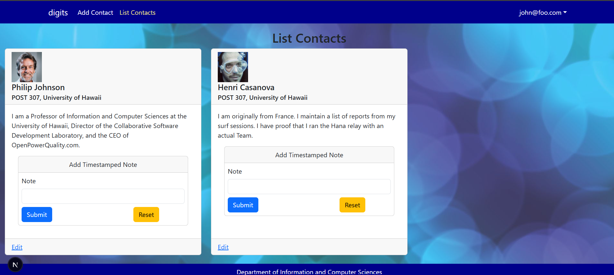
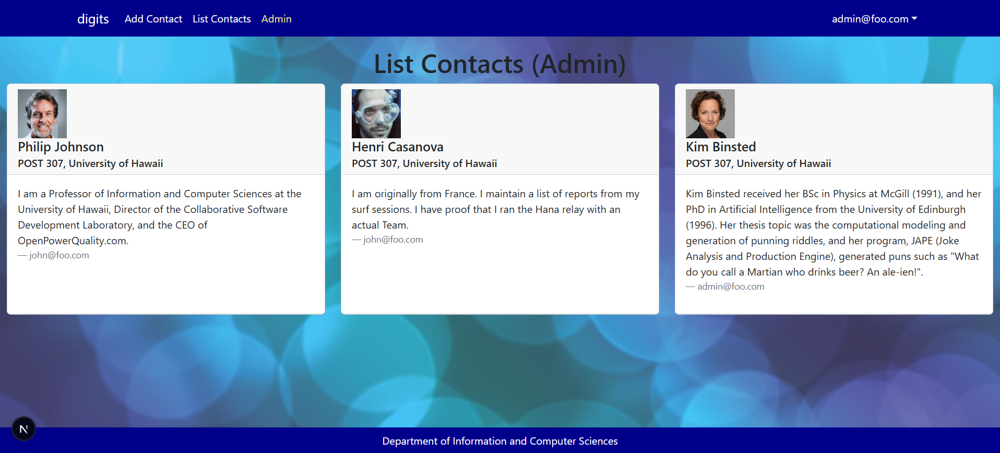

# Digits

Digits is a private, multi-user address book for keeping track of business
contacts and the conversations you have with them. Each account has its own
contact list, with notes and dates attached to contacts to help you remember
past interactions. Administrators can review contacts and notes across all
accounts.

## What you can do

- Create an account, sign in, sign out, and change your password.

- Add contacts with a name, address, image, and description.

- View and edit contacts in your list.

- Add timestamped notes to contacts to record conversations or follow-ups.
- As an administrator, view contacts and notes from all users.


## Getting started

### Requirements

- Node.js and npm
- PostgreSQL

### Setup

1. Install the project dependencies:

   ```bash
   npm install
   ```

2. Copy `sample.env` to `.env` and set `DATABASE_URL` to your PostgreSQL
   connection string. Keep `.env` private; do not commit it.

3. Apply the database migrations and generate the Prisma client:

   ```bash
   npx prisma migrate dev
   npx prisma generate
   ```

4. Load the default development accounts and sample contacts:

   ```bash
   npm run seed
   ```

   The seed data is in [`config/settings.development.json`](config/settings.development.json).
   Seeded development accounts use the password `changeme`; change it after
   signing in, and do not use these credentials outside local development.

5. Start the development server:

   ```bash
   npm run dev
   ```

   Open [http://localhost:3000](http://localhost:3000).

## Using Digits

Sign in or create an account from the Login menu. Once signed in, use **Add
Contact** to save a contact, or **List Contacts** to see your contacts.

A contact includes a first and last name, address, image URL, and description.
From the contact list, you can edit contact details and add notes. Notes are
shown with the date they were created.

Contacts and notes are associated with the account that created them. Regular
users see their own contacts and notes. Accounts with the `ADMIN` role can open
the **Admin** page to review all contacts, including each contact's owner, and
the notes recorded for those contacts.

## Project structure

- `src/app/` contains the pages and routes, including authentication, contact
  management, and the admin view.
- `src/components/` contains reusable interface elements and forms.
- `src/lib/` contains authentication, database, validation, and access-control
  helpers.
- `prisma/schema.prisma` defines the PostgreSQL data model.
- `prisma/migrations/` contains versioned database migrations.
- `prisma/seed.ts` loads the development users and contacts.
- `config/settings.development.json` holds the sample development data.
- `tests/` contains Playwright end-to-end tests.

The database stores users, contacts, and notes. A note belongs to a contact and
includes its text, owner, and creation timestamp.

## Development checks

Run ESLint:

```bash
npm run lint
```

Run the Playwright end-to-end tests:

```bash
npx playwright test
```

Build and start the production version:

```bash
npm run build
npm start
```

Digits is built with Next.js, React, React Bootstrap, NextAuth, Prisma, and
PostgreSQL.
